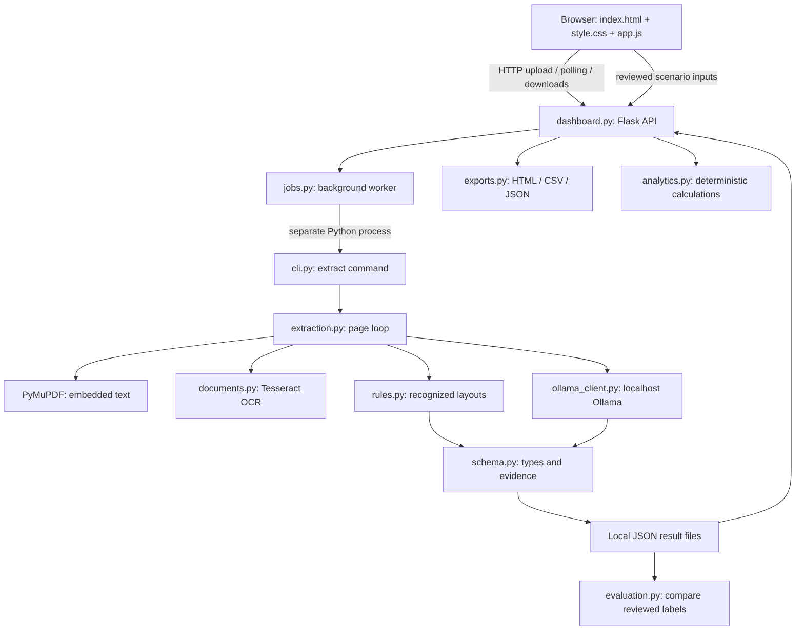

# Application architecture

## One-sentence description

Greenworks is a local web application that converts electricity-bill PDFs into reviewable structured data using PDF text extraction, OCR, layout rules and optional local LLM inference; a separate calculator estimates savings and emissions from reviewed inputs.

It is a Python application with a browser frontend, not a newly trained model.

## Components and boundaries



## What every file does

| File | Main entry point or concept | Responsibility |
|---|---|---|
| `START_DASHBOARD.cmd` | Windows double-click launcher | Runs the PowerShell startup script from the project folder. |
| `scripts/start_dashboard.ps1` | Startup checks | Starts Flask if needed, attempts to start Ollama, verifies the local service and opens the browser. |
| `billintel/__init__.py` | Python package marker | Makes the application importable as `billintel`. |
| `billintel/dashboard.py` | `create_app()` | Creates Flask; validates uploads; registers health, upload, job, preview, export and scenario routes. It delegates extraction and calculations. |
| `billintel/jobs.py` | `run_job()`, `result_for()` | Executes the CLI in a background subprocess, writes logs, updates job state and reads saved page results. A lock serializes extraction jobs. |
| `billintel/cli.py` | `main()` | Parses `models`, `inventory`, `extract`, `analyze` and `evaluate` commands. Also lets the web worker reuse exactly the same extraction entry point. |
| `billintel/extraction.py` | `extract()` | Hashes the PDF, loops through pages, selects text/OCR/vision, chooses rules or LLM, checks evidence, quarantines unsupported numeric candidates and saves progress. Contains the extraction prompt. |
| `billintel/documents.py` | `inventory()`, `ocr_page()` | Counts PDF pages and text availability; renders scanned pages for the locally installed Tesseract executable. Temporary OCR images are removed after recognition. |
| `billintel/ollama_client.py` | `api()`, `check_model()`, `local_models()` | Calls `127.0.0.1:11434`, disables environment HTTP proxies for these requests, checks local-model metadata, and lists installed models. Does not download models. |
| `billintel/rules.py` | `parse_rules()` | Parses known MSEDCL, TANGEDCO and solar-supply patterns. Returns null for unmatched fields and no match for unknown layouts. Checks solar line arithmetic before computing a derived quantity. |
| `billintel/schema.py` | `PageExtraction`, `EvidenceValue`, `review_issues()` | Defines allowed types/units and required output shape. Checks quoted evidence, numeric support and energy-source labels. A Pydantic schema is a data contract, not an AI model. |
| `billintel/analytics.py` | `Scenario`, `analyze()` | Validates reviewed scenario inputs and computes accounted energy, renewable share, net savings, avoided emissions and screening recommendations. No LLM is used for the arithmetic. |
| `billintel/exports.py` | `render_export()` | Converts saved extraction results into JSON, CSV or standalone HTML. Escapes HTML content and guards text CSV cells against formula interpretation. |
| `billintel/evaluation.py` | `evaluate()` | Compares extracted fields with separately reviewed labels for the same PDF hash. Checks numeric value and unit, counts missing/error pages as failures and returns per-field results. |
| `billintel/web/index.html` | Page structure | Upload form, processing controls, results panels, source preview and scenario form. |
| `billintel/web/style.css` | Presentation | Colors, typography, layout, responsive rules and print styles. No extraction logic. |
| `billintel/web/app.js` | Browser controller | Sends uploads, polls jobs every two seconds, renders selected-page metrics/evidence, manages in-session history and submits scenario inputs. Some simple display recommendations live here. It does not call Ollama directly. |
| `examples/scenario.json` | Synthetic inputs | Reproducible fictional energy/cost/emissions calculation, never a real company's claimed savings. |
| `tests/test_pipeline.py` | Core regression tests | Schema, evidence rejection, OCR/model routing, provenance, evaluation and arithmetic. |
| `tests/test_rules.py` | Parser tests | Known layouts, HSN versus energy, kWh versus kVAh, discount distinctions and arithmetic mismatches. |
| `tests/test_dashboard.py` | API/integration tests | Invalid requests, local-origin checks, real worker subprocess, image preview, exports and scenario API. |
| `pyproject.toml` | Package configuration | Python requirements, dependencies, command entry point, frontend packaging and pytest configuration. |
| `.gitignore` | Repository exclusions | Keeps private datasets, generated results, local caches and environments out of Git. |

## Trace one PDF from upload to report

1. `app.js` sends a multipart form containing the PDF, extraction mode, model name and page limit to `POST /api/upload`.
2. `dashboard.py` checks extension, mode, page limit, readable PDF structure, encryption and page count. The HTTP body limit is 30 MB; PDFs may contain 1–100 pages. Uploaded names are display labels; storage uses a generated job ID and fixed `upload.pdf` filename.
3. The PDF is saved to `output/dashboard/<job-id>/upload.pdf`. The route creates an in-memory job record and starts a worker thread, then returns HTTP 202 with its ID.
4. `jobs.py` waits for the single extraction lock, sets the job to running and launches `python -m billintel.cli extract ...` as a subprocess. This keeps slow OCR/inference outside the HTTP request and separates extraction's PDF processing from server preview rendering.
5. `cli.py` calls `extraction.extract()`. The PDF's SHA-256 is recorded as provenance. This is not semantic invoice deduplication.
6. For each page, PyMuPDF reads embedded text. Fewer than 80 non-whitespace text characters triggers the scan heuristic. With dashboard uploads, local OCR is enabled. That threshold is a routing heuristic, not a guarantee of OCR quality.
7. In hybrid mode, `rules.py` tries the recognized layout. If recognized, its output is used and missing fields remain null. If unknown, the prompt, page text and JSON schema go through `ollama_client.py` to the locally installed model. Rules-only errors on unknown pages; model-only bypasses rules.
8. Pydantic validates the output. Evidence checks run. For text/OCR LLM results, numeric candidates with missing quotes, unsupported numbers or absent source labels are moved into `rejected_candidates` and their accepted fields become null. This cannot catch every semantic error.
9. Results are saved after every page using a temporary file and atomic replacement. Page errors are retained and later pages can continue.
10. The browser polls `GET /api/jobs/<id>`. Flask reads the latest JSON and returns progress. The preview route renders the selected original page as PNG. The browser displays values for that page, not an automatic total of the entire PDF.
11. Download routes call `exports.py`. JSON retains detailed extraction metadata; CSV provides flat fields; HTML provides a readable standalone report.

## API routes

| Method and path | Purpose |
|---|---|
| `GET /` | Dashboard HTML |
| `GET /assets/...` | Local CSS and JavaScript |
| `GET /api/health` | App identity and local Ollama availability/models |
| `POST /api/upload` | Validate/store PDF and queue processing |
| `GET /api/jobs/<id>` | Job state and available page results |
| `GET /api/jobs/<id>/pages/<page>` | Original-page PNG preview |
| `GET /api/jobs/<id>/download/<kind>` | HTML, CSV or JSON report |
| `POST /api/scenario` | Validate reviewed inputs and calculate estimates |

## Storage and state

There is no database, Redis or cloud storage in this prototype.

```text
EB bills/                        Original electricity dataset, private
Procurement Invoices/            Separate source data; unsupported task, private
output/dashboard/<job-id>/
  upload.pdf                     Local copy of uploaded bill
  processing.log                 Worker stdout/stderr
  result/<name>-<hash>.json       Incremental page extraction
output/extractions/              CLI outputs from earlier runs
output/review/                   Saved review evidence/report backup
output/reviewed-labels.json      Manually checked labels
```

Job state is in Flask memory. Browser history is a JavaScript Map. Neither is restored after restart/refresh; files remain on disk. The extraction subprocess reads the original upload and writes its own result file. One extraction job runs at a time, with up to three active/queued jobs admitted by the web app. This is a lightweight single-user worker, not a durable job queue.

Job states: `queued` → `running` → `done`, `partial` or `error`. A page can be `needs_review` or `error`. `complete=true` means every PDF page processed without a page error, not that the data was verified. A limited preview may have job status `done` while the document's `complete` flag is false.

## Data contracts

`PageExtraction` includes supplier, consumer, account/invoice number, billing period and typed numeric fields. Numeric fields carry `value`, `unit` and `quote`. Units distinguish kWh, kVAh, kW, kVA, INR, INR/kWh and a power-factor ratio. Unknown fields are null.

A page result also has page number, input method, selected engine/model, status, issues, rejected candidates and optional derived values. Solar supply sums are placed in `derived` with a formula and contributing line items. They are not assumed to be total facility consumption or delivered renewable energy.

`Scenario` is a separate input model. It requires a site, period, assumptions source, `reviewed=true`, mutually exclusive energy inputs, rates, costs and emission factors. The checkbox is a user's attestation, not an automated reconciliation system.

## Savings and emissions are a separate branch

The upload report does **not** automatically feed all values into the calculator. That is intentional: bills may not establish delivered solar energy, losses, marginal grid tariffs or total renewable costs. The user enters reviewed inputs through the scenario form.

- Accounted energy = grid import used + solar used + wind used.
- Renewable share = (solar + wind used) / accounted energy × 100.
- Estimated savings = renewable used × avoided marginal grid rate − all-in renewable cost + export credit.
- Estimated avoided kg CO2e = renewable used × (grid factor − renewable factor).

Fixed grid charges are assumed unchanged. Exports are excluded from consumed-energy and emissions estimates; export credit is separate. Rates and emission factors in the example are illustrative. Recommendations are screening suggestions, not engineering designs or a certified carbon inventory.

## Why this design

- **Flask + plain HTML/CSS/JS:** small local application; no frontend build or hosted service needed at runtime.
- **PDF text before OCR:** use embedded text when available; OCR is needed for scans and can introduce digit errors.
- **Rules plus Ollama:** known formats benefit from explicit numeric parsing; the pretrained model is a fallback, not the source of every field.
- **Schema plus evidence:** valid JSON alone does not establish correctness, so type/unit constraints and source checks are separate.
- **Subprocess worker:** a long-running page does not hold open the upload HTTP request; the browser polls progress.
- **Deterministic analytics:** arithmetic is reproducible, and assumptions are explicit.
- **No automatic page aggregation:** multi-invoice PDFs and repeated totals make naive summing unsafe.

## What this application is not

The dashboard itself does not train models. Experimental CPU LoRA tools are isolated under `training/` (see [TRAINING.md](TRAINING.md)). No RAG/vector database, automatic invoice reconciliation, robust duplicate-invoice detection, production authentication, durable job scheduler or procurement-invoice extractor is implemented. Vision support exists only as an optional CLI path and is not validated on this dataset. The dashboard uses OCR for scans.

The Flask development server is for a local single-user prototype. Loopback binding and origin checks are not a full security or network-isolation audit. Source text remains untrusted; quotes and numeric checks reduce mistakes but do not prove accuracy.

## Code walkthrough order for your TL

1. `README.md`: purpose, start command and scope.
2. `web/app.js`: upload handler and `poll()`.
3. `dashboard.py`: `create_app()` and upload/status routes.
4. `jobs.py`: `run_job()` and CLI subprocess.
5. `extraction.py`: `extract()` page loop and prompt.
6. `documents.py`, `rules.py`, `ollama_client.py`: the three input/extraction mechanisms.
7. `schema.py`: types, units, evidence and rejection.
8. `exports.py`: report generation.
9. `analytics.py`: reviewed inputs and formulas.
10. `evaluation.py` and `tests/`: quality measurement and regression protection.

## Experimental training boundary

`training/prepare_data.py` creates private draft annotations and grouped datasets; `training/train_lora.py` trains a separate adapter in `.venv-training`. These are developer tools, not dashboard request handlers. Draft candidates are not treated as verified labels. Experimental checkpoints stay under `output/training/` and are not automatically imported into Ollama.

## Cleanup performed

Separated the Ollama client, OCR/inventory helpers, worker and export rendering from the orchestration/routes. Expanded compressed frontend code and formatted Python consistently. Removed the obsolete static-demo generator (`billintel/report.py`, `scripts/prepare_review.py`, `RUN_REVIEW_DEMO.cmd`), which duplicated the maintained dashboard workflow. Preserved private datasets, labels, uploads and saved reports. Moved disposable caches and exploratory screenshots/test scripts into the ignored `output/cleanup-archive-2026-11-17/` folder after verification. Recursive deletion was blocked by automatic approval review, so this part of cleanup is reversible.
